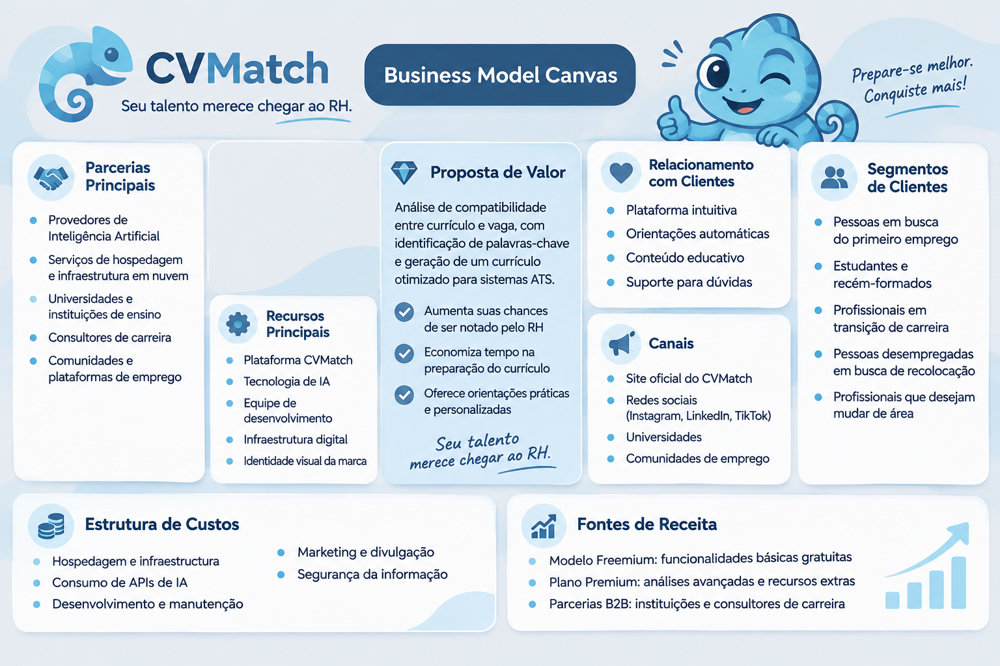

# 🦎 CVMatch — Seu talento merece chegar ao RH

O **CVMatch** é uma aplicação web que utiliza Inteligência Artificial para ajudar candidatos a comparar seus currículos com descrições de vagas, identificar oportunidades de melhoria e otimizar suas informações profissionais para processos seletivos.

A proposta é tornar a preparação de currículos mais simples e estratégica, ajudando os candidatos a destacar suas qualificações de acordo com os requisitos de cada oportunidade.

## 🌐 Acesse a Aplicação

**[🚀 Conheça o CVMatch](https://image-guided-spec.lovable.app/)**

## 🎯 Objetivo do Projeto

Desenvolver uma ferramenta inteligente que auxilie candidatos na preparação de currículos mais alinhados às vagas desejadas, considerando palavras-chave e requisitos utilizados em sistemas ATS (*Applicant Tracking Systems*).

## ✨ Funcionalidades

- **Importação de currículo em PDF:** permite que o usuário envie seu currículo em formato PDF para leitura e extração das informações.
- **Inserção de currículo por texto:** oferece a opção de colar o conteúdo do currículo diretamente na plataforma.
- **Análise de compatibilidade:** compara o currículo com a descrição da vaga e apresenta um percentual de compatibilidade.
- **Identificação de palavras-chave:** destaca os termos encontrados e os requisitos que podem estar ausentes.
- **Análise de competências:** identifica competências e requisitos mencionados na descrição da vaga.
- **Sugestões de melhoria:** apresenta recomendações para tornar o currículo mais alinhado à oportunidade.
- **Otimização de currículo:** gera uma versão aprimorada, com linguagem profissional e organização das informações.
- **Exportação:** permite copiar o currículo otimizado e exportá-lo em PDF.

**Compromisso com a veracidade:** o CVMatch não deve inventar experiências, qualificações, formações ou competências. As sugestões devem respeitar as informações reais fornecidas pelo candidato.

## 🎥 Demonstração do Projeto

Confira a demonstração do CVMatch em funcionamento:

[▶️ Assistir à demonstração no YouTube](https://www.youtube.com/watch?v=BXTlM1T0IJY)

**🔔 Dica:** Ao acessar o vídeo, verifique se a qualidade de reprodução está configurada em **1080p (Full HD)**. Caso esteja em uma resolução inferior, clique na engrenagem ⚙️ do YouTube, selecione **Qualidade → 1080p** para assistir à demonstração com melhor definição.

## 🧠 Mega Prompt — Desenvolvimento com IA

O desenvolvimento da aplicação começou com a elaboração de um Mega Prompt, utilizado no Lovable para transformar a proposta do CVMatch em um produto digital.

O prompt foi estruturado para orientar a criação das funcionalidades, da identidade visual, da experiência do usuário e do mascote interativo.

<strong>📋 Clique aqui para visualizar o Mega Prompt completo</strong>

### MEGA PROMPT — CVMatch

Crie uma aplicação web chamada **CVMatch**, uma ferramenta inteligente que ajuda candidatos a adaptar seus currículos às vagas de emprego, aumentando a compatibilidade com sistemas ATS (Applicant Tracking Systems).

**Slogan:** Seu talento merece chegar ao RH.

O projeto deve ter uma interface moderna, intuitiva, acolhedora e profissional, totalmente em português.

### 1. Objetivo da aplicação

O CVMatch deve permitir que o usuário compare seu currículo com uma descrição de vaga e receba uma análise de compatibilidade.

A ferramenta deve identificar palavras-chave encontradas e ausentes, apresentar um percentual de compatibilidade e ajudar o candidato a melhorar seu currículo de acordo com os requisitos da oportunidade.

O sistema também deve gerar uma versão otimizada do currículo, mantendo a veracidade de todas as informações fornecidas pelo usuário.

### 2. Funcionalidades principais

**A. Inserção de informações**

- Campo de texto para o usuário colar a descrição da vaga.
- Campo de texto para inserir o conteúdo do currículo.
- Botão para iniciar a análise.

**B. Análise de compatibilidade**

Após a análise, apresentar:

- Percentual de compatibilidade entre currículo e vaga.
- Palavras-chave encontradas no currículo.
- Palavras-chave importantes que estão ausentes.
- Competências e requisitos identificados.
- Sugestões práticas para melhorar o currículo.

**C. Otimização do currículo**

Criar um botão para gerar uma versão otimizada do currículo, considerando os requisitos da vaga.

A versão gerada deve:

- Utilizar palavras-chave relevantes da descrição da vaga.
- Melhorar a organização e a clareza das informações.
- Utilizar linguagem profissional.
- Preservar as experiências, formações e competências reais do candidato.
- Permitir copiar o currículo otimizado.
- Oferecer opção de exportação em PDF.

**Regra fundamental:** Nunca invente experiências profissionais, empresas, formações, certificados, competências ou resultados. O sistema deve trabalhar exclusivamente com as informações fornecidas pelo usuário. Caso identifique um requisito ausente, deve apenas informar isso e sugerir que o candidato o inclua se realmente possuir aquela experiência ou competência.

### 3. Identidade visual

Desenvolva uma identidade visual moderna, leve e profissional, utilizando a seguinte paleta:

- Cinza-claro: `#E5E8EB` — fundo principal.
- Azul-claro: `#B9D9EF` — destaques suaves e elementos secundários.
- Azul: `#244D73` — títulos, botões e elementos de destaque.
- Branco: `#FFFFFF` — cartões, campos de preenchimento e áreas de conteúdo.

Utilize cantos arredondados, sombras discretas, boa organização visual e espaçamento confortável.

A interface deve transmitir confiança, tecnologia, inteligência e acolhimento.

### 4. Mascote interativo — Camaleão

Crie um camaleão fofo e simpático como mascote do CVMatch.

Características:

- Aparência amigável, moderna e expressiva.
- Tons predominantes de azul e azul-claro.
- Design delicado, com personalidade e fácil identificação.
- Deve combinar com a identidade visual da aplicação.

**Animação de entrada:**

Quando o usuário entrar no aplicativo:

- O camaleão deve aparecer na tela.
- Deve fazer um pequeno movimento de aceno com uma das patinhas, como se estivesse cumprimentando o usuário.
- Durante o aceno, deve mudar de cor suavemente, passando por tons de azul, azul-claro e outras cores suaves.
- A animação deve ser curta, delicada e agradável.

Depois da animação, o mascote pode permanecer discretamente em um canto da interface.

Mantenha o mesmo personagem e estilo visual em toda a aplicação. Evite animações exageradas ou que atrapalhem a navegação.

### 5. Experiência do usuário

A aplicação deve ser simples e intuitiva, permitindo que qualquer pessoa consiga utilizá-la sem conhecimentos técnicos.

Organize o fluxo da seguinte maneira:

1. O usuário acessa o CVMatch.
2. Insere a descrição da vaga.
3. Cola o conteúdo do currículo ou importa um arquivo PDF.
4. Solicita a análise.
5. Visualiza o percentual de compatibilidade e os resultados.
6. Solicita a otimização do currículo.
7. Copia ou exporta o resultado.

Inclua mensagens claras de carregamento, sucesso e erro. Os botões devem funcionar e fornecer retorno visual ao usuário.

### 6. Requisitos técnicos e limites do MVP

- Desenvolver uma aplicação web responsiva, adaptada para computadores e dispositivos móveis.
- Utilizar componentes modernos e reutilizáveis.
- Manter uma interface organizada e acessível.
- Garantir que os campos e botões tenham funcionamento real.
- Implementar a análise e a geração do currículo de forma funcional, utilizando integração de IA disponível na plataforma, se necessária.
- Não apresentar resultados fictícios como se fossem análises reais.
- Caso a integração de IA não esteja configurada, informar claramente essa limitação.

**Importante:** Nesta primeira versão, não criar login, cadastro, banco de dados, pagamentos, painel administrativo, histórico de análises ou integrações externas desnecessárias.

Priorize um MVP funcional, bonito e fácil de testar, sem adicionar funcionalidades que não foram solicitadas.

### 7. Resultado esperado

Entregar uma aplicação chamada CVMatch, com identidade visual própria, mascote interativo e funcionalidades de comparação e otimização de currículos.

O resultado deve parecer um produto digital real, com boa experiência de uso e apresentação profissional, pronto para ser demonstrado em um portfólio.

## 🎨 Identidade Visual

A identidade visual foi pensada para transmitir tecnologia, confiança e acolhimento.

**Paleta de cores:**

| Cor | Código | Aplicação |
|---|---|---|
| Azul | `#244D73` | Títulos e botões |
| Azul-claro | `#B9D9EF` | Destaques |
| Cinza-claro | `#E5E8EB` | Fundo principal |
| Branco | `#FFFFFF` | Cartões e campos |

**Mascote:** um camaleão simpático, que representa adaptação e transformação. Ele possui uma animação de entrada com um aceno e mudanças suaves de cor.

## 🛠️ Tecnologias e Ferramentas

- **Lovable:** desenvolvimento da aplicação com auxílio de IA.
- **Inteligência Artificial:** análise de compatibilidade e otimização de currículos.
- **GitHub:** versionamento e apresentação do projeto.

## 📊 Business Model Canvas

O modelo de negócio foi estruturado considerando uma proposta Freemium, com funcionalidades básicas gratuitas e possibilidade de recursos Premium.

## 🚧 Status do Projeto

Projeto em desenvolvimento, sujeito a testes, ajustes e melhorias. As funcionalidades estão sendo avaliadas para aprimorar a experiência do usuário e a confiabilidade das análises.

## 📌 Autoria

**Bianca Ramos**

Projeto desenvolvido para um desafio prático da **DIO (Digital Innovation One)**, explorando o desenvolvimento de aplicações com Inteligência Artificial e ferramentas de criação assistida.

Sinta-se à vontade para conhecer o projeto!
